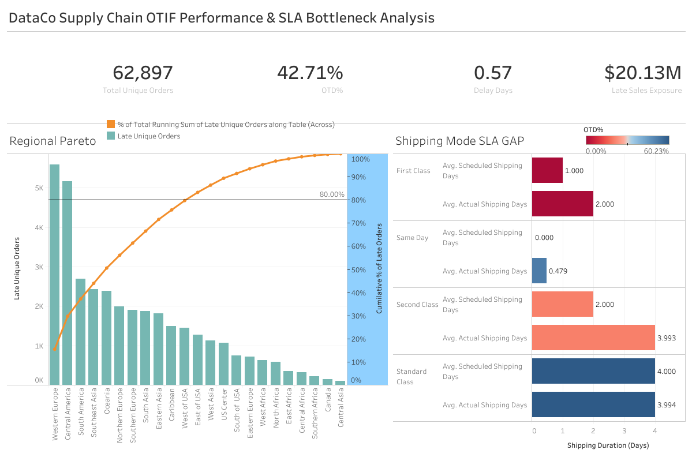

# Global Supply Chain Delivery & SLA Bottleneck Analysis (DataCo)

🔗 **[Explore the Interactive Dashboard on Tableau Public](https://public.tableau.com/app/profile/luis.fernando.salas.valencia4381/viz/DataCoSCOTIFAnalysis/Dashboard1)**



## Why I Built This
Having worked on a fulfillment center floor, I know how quickly missed carrier cutoffs and unrealistic shipping promises turn into customer complaints and margin loss. I wanted to strengthen my data analysis skills and take a messy, multi-year global order dataset (DataCo Supply Chain, **180,519 line items**) and run a realistic root-cause investigation from raw database tables up to an interactive dashboard.

Instead of just tracking overall late orders, I focused on two questions an operations manager actually cares about:
1. **Where are our Service Level Agreements (SLAs) broken vs. where is warehouse/carrier execution falling behind?**
2. **Which regions are driving the majority of our late-order volume and revenue at risk?**

---

## What Jumped Out in the Data

After cleaning out canceled and suspected-fraud orders so they wouldn't skew transit times, I ended up with **62,897 unique shipped orders**. Across the whole network, On-Time Delivery (OTD) sits at **42.71%**, putting **$20.13M** in sales behind late shipments.

Digging deeper into shipping tiers and regions revealed three clear operational issues:

### 1. The "Second Class" Illusion
Customers paying for **Second Class** shipping are promised a **2-day** delivery window, yet orders actually take **3.99 days** on average—virtually identical to **Standard Class** (**3.99 days**). In practice, customers are paying extra for expedited handling and getting standard ground execution. That single gap produces the widest average delay (**+1.99 days**), a **20.17% OTD rate**, and **$5.48M** in late sales exposure.

### 2. First Class Is Promising the Impossible
Every single one of the **9,602 First Class** orders took **2.00 days** against a **1.00-day** promise (**0.00% OTD**), putting **$5.41M** at risk. When a tier fails 100% of the time across thousands of orders, it isn't random carrier variance—the customer-facing SLA is miscalibrated for the fulfillment network. Together, **First Class** and **Second Class** make up **54.1% ($10.89M)** of total late sales exposure despite accounting for only **34.7%** of order volume.

### 3. Same Day Cutoff Friction
**Same Day** orders hit **52.07% OTD** (**0.48** average actual days vs. a **0-day** same-day SLA). Unlike First Class, the network *can* hit same-day fulfillment more than half the time—the 48% miss rate points to an afternoon order-cutoff or wave-release bottleneck where late orders miss the evening carrier pickup and roll into the next morning.

| Shipping Mode | Unique Orders | Avg Scheduled (Days) | Avg Actual (Days) | Avg Delay (Days) | OTD % | Late Sales Exposure |
| :--- | :---: | :---: | :---: | :---: | :---: | :---: |
| **First Class** | 9,602 | 1.00 | 2.00 | +1.00 | 0.00% | $5,408,560 |
| **Second Class** | 12,256 | 2.00 | 3.99 | +1.99 | 20.17% | $5,477,970 |
| **Same Day** | 3,407 | 0.00 | 0.48 | +0.48 | 52.07% | $876,286 |
| **Standard Class** | 37,632 | 4.00 | 3.99 | -0.01 | 60.23% | $8,365,460 |
| **Total / Network** | **62,897** | — | — | **+0.57** | **42.71%** | **$20,128,276** |

### 4. Two Regions Drive Nearly 30% of All Delays
Using a Pareto breakdown across all 23 global regions, late deliveries aren't spread evenly:
* **Western Europe** (`5,585` late orders) and **Central America** (`5,156` late orders) alone account for **29.80%** of all late shipments.
* The top **5 regions** (adding South America, Southeast Asia, and Oceania) drive **50.60%** of total delays.
* The **80% Pareto threshold** hits at **11 of 23 regions** (through West of USA at **79.76%**), meaning fixing hub and carrier bottlenecks in the top few markets will move the needle far more than chasing low-volume tail regions.

---

## Practical Next Steps I'd Recommend
* **Fix the First Class promise:** Update quoted lead times from 1 day to 2 days (or geo-fence 1-day shipping to local air-hub zones) so we stop guaranteeing delivery windows the network cannot physically meet.
* **Separate Second Class wave routing:** Audit why Second Class orders are moving at the exact same speed as Standard Class (`3.99` days) and isolate their pick/pack waves and carrier sortation.
* **Target Western Europe & Central America first:** Focus 3PL carrier performance reviews and lead-time buffers on the top two regions before spending bandwidth on the bottom half of the Pareto curve.

---

## How I Built It
* **PostgreSQL & DBeaver (`01_create_delivery_view.sql`):** Imported the raw CSV (`ISO-8859-1` encoding), standardized messy column headers, parsed string timestamps, filtered out `CANCELED` and `SUSPECTED_FRAUD` records, and built a clean analytical view (`otif_project.vw_delivery_performance`) with row-level flags (`is_on_time`, `delay_days`, `late_sales_exposure`).
* **SQL Aggregation & Window Functions (`02_pareto_analysis.sql`):** Wrote CTE-based queries using `COUNT(DISTINCT CASE WHEN ...)` to prevent multi-item orders from inflating order counts, alongside `DENSE_RANK()` and running `SUM() OVER()` window functions to calculate the regional 80/20 cutoff.
* **Tableau Public (`otif_dashboard.png`):** Exported the cleaned view to build a `1200 x 800` interactive dashboard combining an executive KPI banner, a dual-axis regional Pareto chart, and a paired SLA gap comparison with click-to-filter interactivity across views.

---

## Files in This Repo
```text
├── README.md                     # Project story, findings, and dashboard preview
├── 01_create_delivery_view.sql   # PostgreSQL cleaning & KPI feature engineering view
├── 02_pareto_analysis.sql        # SLA gap metrics & window-function Pareto queries
└── otif_dashboard.png            # High-res export of the Tableau Public dashboard